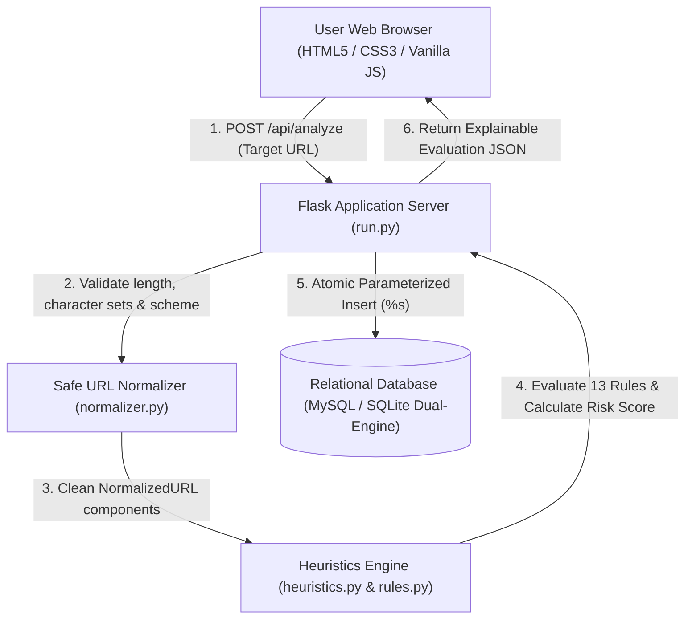

# 🛡️ PhishAware: Secure Phishing Awareness & URL Risk Checker

[](https://www.python.org/)
[](https://palletsprojects.com/p/flask/)
[](https://www.mysql.com/)
[-brightgreen.svg)](https://docs.pytest.org/)
[](LICENSE)
[]()

> An educational, defense-in-depth web application that evaluates user-submitted URLs through **transparent, explainable heuristic analysis** and teaches proactive safe browsing practices.

---

## 📌 Critical Security & Educational Principles

> [!IMPORTANT]
> **1. Zero Outbound Requests Protocol (No Web Fetching / DNS)**  
> This application **never visits, crawls, or resolves** user-submitted URLs. Performing outbound HTTP requests from a server introduces critical vulnerabilities, including **Server-Side Request Forgery (SSRF)**, local network port scanning, and drive-by malware delivery. All evaluations are performed **100% offline via static syntactic analysis**.
>
> **2. Heuristic Indicators $\neq$ Definitive Proof**  
> Heuristics detect structural warning signs, obfuscation patterns, and known deceptive techniques. **Heuristic results are NOT definitive proof that a URL is safe or malicious.** Clean scores do not guarantee safety, and legitimate sites may occasionally trigger false positives.

---

## ✨ Key Features

- **Transparent Heuristics Engine**: 13 discrete heuristic rules evaluating IP hostnames, credential `@` injection, excessive subdomains, brand impersonation, high-risk TLDs, punycode lookalikes, and open redirects.
- **Explainable Risk Scoring**: Detailed breakdown for every triggered rule, explaining *what was detected*, *why attackers use it*, and *actionable safety guidance*.
- **Interactive Risk Gauge**: Visual score (0–100) and risk tier classification (`LOW_RISK`, `SUSPICIOUS`, `HIGH_RISK`).
- **Resilient Dual-Engine Database**: Primary **MySQL 8.0** engine with automatic, zero-configuration **SQLite fallback** if credentials are not configured.
- **100% SQL Injection Immunity**: All database reads, inserts, and searches use strict **parameterized queries** (`%s` / `?`).
- **Hardened HTTP Security Headers**: Content Security Policy (CSP), `X-Frame-Options: DENY` (anti-clickjacking), `X-Content-Type-Options: nosniff`, and `Referrer-Policy`.
- **Searchable Audit Trail & History**: Filter by risk level, search by hostname or URL string with debounced client queries.
- **Telemetry & Statistics**: Aggregate metrics on total scans, average risk score, risk distribution, and top triggered rules leaderboard.
- **Educational Mini-Quiz & Guide**: Interactive safe browsing lessons teaching users how to deconstruct URLs and identify traps.

---

## 🏗️ System Architecture



---

## 📋 The 13 Heuristic Rules Catalog

| Rule ID | Rule Name | Category | Weight | Attacker Tactic & Explanation |
| :--- | :--- | :--- | :---: | :--- |
| **HR-01** | `IP_AS_HOSTNAME` | Hostname | +35 | Raw IP addresses are used in disposable phishing kits to bypass domain registration costs. |
| **HR-02** | `CREDENTIAL_AT_SYMBOL` | Authority | +40 | The `@` symbol tricks users: browsers ignore text before `@` and navigate to the domain *after* it. |
| **HR-03** | `EXCESSIVE_SUBDOMAINS` | Hostname | +20 | 3+ subdomains push the real root domain offscreen on mobile or shortened address bars. |
| **HR-04** | `SUSPICIOUS_KEYWORD_IN_SUBDOMAIN`| Hostname | +25 | Words like `login` or `bank` placed in subdomains of unrelated domains create false authenticity. |
| **HR-05** | `HIGH_RISK_TLD` | Hostname | +15 | Ultra-cheap or free TLDs (`.xyz`, `.top`, `.click`, `.buzz`) frequently host burner phishing sites. |
| **HR-06** | `PUNYCODE_HOMOGLYPH` | Hostname | +35 | Non-Latin characters (e.g. Cyrillic 'а') mimic Latin letters in Internationalized Domain Names. |
| **HR-07** | `NON_STANDARD_PORT` | Authority | +20 | Consumer sites rarely use ports other than 80/443; custom ports often indicate rogue servers. |
| **HR-08** | `EXCESSIVE_URL_LENGTH` | Structure | +15 | URLs $>100$ characters often bury malicious redirect tokens or long encoded parameters. |
| **HR-09** | `MULTIPLE_HYPHENS` | Hostname | +15 | Hyphenated chains (`paypal-security-account-center.com`) mimic corporate portal domains. |
| **HR-10** | `HEX_OCTAL_IP_OBFUSCATION` | Hostname | +40 | Encoding IPs as integers (e.g. `2130706433`) is an evasion trick to bypass basic regex filters. |
| **HR-11** | `OPEN_REDIRECT_PARAMETER` | Query | +20 | Exploits open redirects (`?redirect=https://evil.com`) to bounce users from trusted domains. |
| **HR-12** | `MISLEADING_BRAND_IN_PATH` | Path/Query | +25 | Brand names placed in the URL path (`site.com/paypal/login`) trick users reading left-to-right. |
| **HR-13** | `UNENCRYPTED_SENSITIVE_CONTEXT` | Structure | +15 | Plain HTTP used for login or banking exposes credentials to local network eavesdropping. |

---

## 🚀 Quickstart & Installation

### Prerequisites
- Python 3.10 or higher
- Git
- (Optional) MySQL 8.0 Server

### 1. Clone the Repository
```bash
git clone https://github.com/your-username/phishaware-url-checker.git
cd phishaware-url-checker
```

### 2. Create and Activate Virtual Environment
```bash
# Windows (PowerShell)
python -m venv venv
.\venv\Scripts\Activate.ps1

# Linux / macOS
python3 -m venv venv
source venv/bin/activate
```

### 3. Install Dependencies
```bash
pip install -r requirements.txt
```

### 4. Configure Database (Optional)
Copy `.env.example` to `.env` and set your MySQL credentials:
```env
DB_HOST=localhost
DB_PORT=3306
DB_USER=root
DB_PASSWORD=your_password
DB_NAME=phishing_checker_db
```
*(If no `.env` is created or MySQL is unreachable, the application automatically uses local `phishing_checker.db` with zero configuration).*

### 5. Initialize Database & Run Server
```bash
python init_db.py
python run.py
```

Open your browser and navigate to **`http://127.0.0.1:5000`**.

---

## 🧪 Running the Automated Test Suite

The test suite validates input sanitization, the 13 heuristic rules, database transaction safety, SQL injection immunity, and API security headers:

```bash
pytest -v
```

**Expected output:**
```text
============================= 37 passed in 4.58s =============================
```

---

## 📁 Project Directory Structure

```text
project_fldr/
├── app/
│   ├── __init__.py           # Flask application factory & security headers
│   ├── database/
│   │   ├── __init__.py
│   │   ├── db.py             # Dual-engine repository (MySQL + SQLite fallback)
│   │   └── schema.sql        # 3NF relational MySQL DDL
│   ├── engine/
│   │   ├── __init__.py
│   │   ├── normalizer.py     # Safe RFC parsing, length caps, scheme checks
│   │   ├── rules.py          # Declarative heuristic rules catalog
│   │   └── heuristics.py     # Evaluation engine & risk scoring
│   ├── routes/
│   │   ├── __init__.py
│   │   ├── api.py            # REST API endpoints (analyze, history, stats)
│   │   └── views.py          # Web interface view controllers
│   ├── static/
│   │   ├── css/styles.css    # Responsive cybersecurity theme
│   │   └── js/main.js        # Client-side DOM logic with zero-XSS sanitization
│   └── templates/
│       ├── base.html         # Base layout with CSP-compliant structure
│       ├── index.html        # Interactive URL Analyzer & results card
│       ├── history.html      # Searchable, filterable scan history
│       ├── stats.html        # Telemetry & distribution statistics
│       └── education.html    # Safe browsing guide & interactive quiz
├── docs/
│   ├── SRS.md                # Software Requirements Specification
│   ├── ARCHITECTURE.md       # Threat model, STRIDE & system architecture
│   ├── DATABASE_DESIGN.md    # ER diagrams, 3NF schema & indexing
│   ├── REPORT.md             # Comprehensive Academic/Professional Report
│   ├── PRESENTATION_OUTLINE.md # 12-Slide PowerPoint presentation outline
│   └── INTERVIEW_QUESTIONS.md# 25 Technical & security interview Q&As
├── tests/
│   ├── test_normalizer.py    # URL normalization and validation tests
│   ├── test_heuristics.py    # Heuristic rule triggers and scoring tests
│   ├── test_db.py            # SQL injection immunity & relational data tests
│   └── test_api.py           # Flask endpoints & security header tests
├── config.py                 # Centralized configuration loaded from .env
├── init_db.py                # Database connectivity & initialization CLI
├── run.py                    # Application entry point
├── requirements.txt          # Python dependencies
└── .gitignore                # Source control protection (secrets, venv)
```

---

## 🔒 Security Best Practices Implemented

1. **SQL Injection Defense**: Strict parameterized statements (`%s` in MySQL, `?` in SQLite). String concatenation is forbidden in all database queries.
2. **Cross-Site Scripting (XSS) Defense**: Jinja2 contextual escaping enabled for all HTML views, paired with `textContent` DOM insertion in JavaScript.
3. **Clickjacking Defense**: `X-Frame-Options: DENY` header blocks framing attacks.
4. **MIME Sniffing Defense**: `X-Content-Type-Options: nosniff` header enforces strict MIME types.
5. **Content Security Policy (CSP)**: Declares permitted script, style, and font origins.
6. **Denial of Service (DoS) Mitigation**: Strict 2,048-character URL length limits prevent ReDoS and memory bloat.

---

## 📄 License
This project is open-source and available under the [MIT License](LICENSE).
