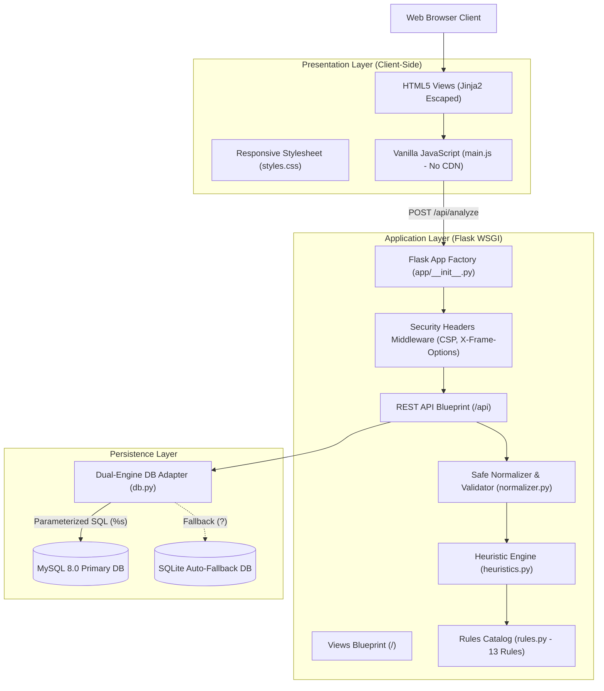
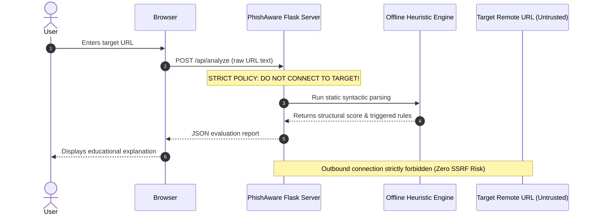

# System Architecture & Threat Model (STRIDE)
## PhishAware: Secure Phishing Awareness & URL Risk Checker

---

### 1. Architectural Overview & Component Decomposition



---

### 2. The Zero-Outbound Requests Architecture



#### Why We Enforce Zero Outbound Connections
In standard web security, accepting a URL from a user and calling `requests.get(url)` or resolving its IP address via DNS on the server exposes the backend to severe hazards:
1. **Server-Side Request Forgery (SSRF)**: An attacker submits `http://169.254.169.254/latest/meta-data/` or `http://localhost:3306` to scan internal services, cloud metadata endpoints, or local databases.
2. **Denial of Service (Slowloris / Tar-pits)**: Malicious servers keep HTTP connections open indefinitely, exhausting the web server's worker threads.
3. **Malware Payload Infection**: Directly downloading executable files or exploit kits into server memory.
4. **Honeypot Detection**: Phishing actors log the IP of scanners and dynamically present benign decoy pages (cloaking).

---

### 3. Threat Model (STRIDE Methodology)

The system was evaluated against the **STRIDE** threat categorization model:

| STRIDE Threat Category | Potential Attack Vector | System Defense & Mitigation Strategy | Residual Risk |
| :--- | :--- | :--- | :---: |
| **Spoofing** | Attacker impersonates legitimate brands using lookalike homoglyphs or misleading subdomains. | Engine implements **HR-06** (Punycode `xn--` detection), **HR-04** (sensitive keywords in subdomains), and **HR-12** (brand in path). | Low |
| **Tampering** | Attacker submits SQL injection payloads (`' OR '1'='1`) into the URL input or history search parameters. | **100% Parameterized queries** (`%s` in MySQL, `?` in SQLite) treat all user inputs strictly as literal string values. | Negligible |
| **Repudiation** | An assessed URL is deleted or modified after a security evaluation. | Assessments and triggered rules are stored in an indexed audit table with immutable timestamps. | Negligible |
| **Information Disclosure** | Database error, syntax failure, or internal path leaked via stack traces. | Centralized error handlers (`400`, `404`, `500`) intercept exceptions and return sanitized JSON messages. | Low |
| **Denial of Service (DoS)**| Attacker submits massive multi-megabyte payloads to trigger Regular Expression DoS (ReDoS) or memory exhaustion. | Strict **2,048-character length cap** and immediate rejection of control characters before parsing. | Low |
| **Elevation of Privilege**| Cross-Site Scripting (XSS) injected into results view or framing inside an iframe (Clickjacking). | **Contextual Jinja2 escaping**, `textContent` DOM insertion in JavaScript, **CSP**, and **`X-Frame-Options: DENY`**. | Negligible |

---

### 4. Defense-in-Depth Security Matrix

```text
+--------------------------------------------------------------------------+
|                        DEFENSE-IN-DEPTH LAYERS                           |
+--------------------------------------------------------------------------+
| Layer 1: Network & Browser Headers                                       |
|   - Content-Security-Policy (Restricted script/font origins)              |
|   - X-Frame-Options: DENY (Anti-Clickjacking)                            |
|   - X-Content-Type-Options: nosniff (Anti-MIME Sniffing)                 |
|   - Referrer-Policy: strict-origin-when-cross-origin                     |
+--------------------------------------------------------------------------+
| Layer 2: Input Sanitization & Validation                                 |
|   - Max 2,048 Character Length Guard                                    |
|   - Control Character & Null-Byte Rejection                              |
|   - Disallowed Pseudo-Scheme Blocking (javascript:, data:, file:)        |
+--------------------------------------------------------------------------+
| Layer 3: Application & Logic                                             |
|   - Completely Offline Parsing (urllib.parse, ipaddress)                 |
|   - Zero Outbound Requests / Zero DNS Lookups                            |
|   - Clamped Risk Scoring (0-100) with Mandatory Disclaimers              |
+--------------------------------------------------------------------------+
| Layer 4: Data Persistence & Storage                                      |
|   - Parameterized SQL Statements (%s / ?)                                |
|   - Relational Foreign Key Cascades (Referential Integrity)              |
|   - Resilient Dual-Engine (MySQL 8.0 Primary with SQLite Fallback)       |
+--------------------------------------------------------------------------+
```
