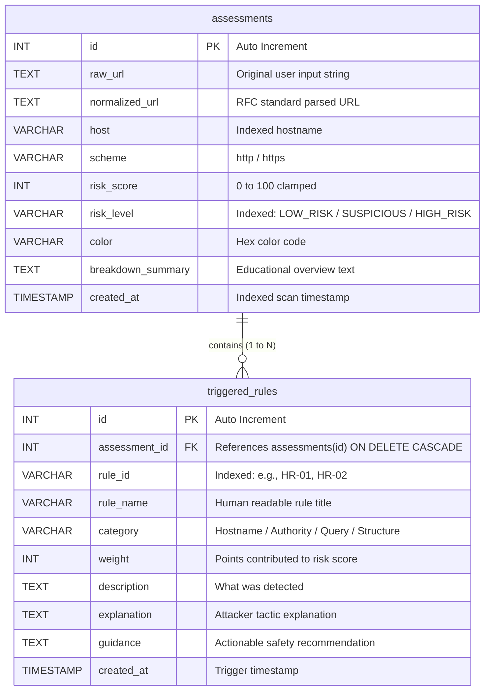

# Relational Database Design & Specification
## PhishAware: Secure Phishing Awareness & URL Risk Checker

---

### 1. Entity-Relationship (ER) Diagram



---

### 2. Relational Normalization Analysis (3NF Compliance)

The database schema is organized in **Third Normal Form (3NF)**:
1. **First Normal Form (1NF)**:
   * Every attribute contains atomic values (no delimited lists of triggered rules stored inside a single column).
   * Each record is uniquely identified by a primary key (`id`).
2. **Second Normal Form (2NF)**:
   * Every non-key column is fully functionally dependent on the entire primary key.
3. **Third Normal Form (3NF)**:
   * No transitive dependencies exist between non-key attributes. Triggered rules exist independently in `triggered_rules` and link back to their parent assessment strictly via `assessment_id`.

---

### 3. Data Dictionary

#### Table 1: `assessments`
Stores the overall metadata and composite score for each evaluated URL.

| Column Name | Data Type | Nullable | Default | Description | Index |
| :--- | :--- | :---: | :---: | :--- | :---: |
| `id` | `INT` | No | Auto Increment | Primary key. Unique scan identifier. | PK |
| `raw_url` | `TEXT` | No | - | Exact raw input string submitted by user. | - |
| `normalized_url`| `TEXT` | No | - | Normalized, standardized URL string. | - |
| `host` | `VARCHAR(255)`| No | - | Extracted hostname or IP address. | `idx_host` |
| `scheme` | `VARCHAR(16)` | No | - | Extracted scheme protocol (`http` or `https`). | - |
| `risk_score` | `INT` | No | - | Composite calculated risk score (0 to 100). | - |
| `risk_level` | `VARCHAR(32)` | No | - | Category (`LOW_RISK`, `SUSPICIOUS`, `HIGH_RISK`). | `idx_risk_level` |
| `color` | `VARCHAR(16)` | No | - | UI display color (`#10b981`, `#f59e0b`, `#ef4444`).| - |
| `breakdown_summary`| `TEXT` | Yes | NULL | Human-readable explanation summary. | - |
| `created_at` | `TIMESTAMP` | No | `CURRENT_TIMESTAMP` | System timestamp when assessment was logged. | `idx_created_at` |

#### Table 2: `triggered_rules`
Stores individual heuristic rules activated during an evaluation.

| Column Name | Data Type | Nullable | Default | Description | Index |
| :--- | :--- | :---: | :---: | :--- | :---: |
| `id` | `INT` | No | Auto Increment | Primary key. Unique rule activation identifier. | PK |
| `assessment_id`| `INT` | No | - | Foreign Key referencing `assessments(id)`. | `idx_assessment_id` |
| `rule_id` | `VARCHAR(16)` | No | - | Rule identifier code (e.g. `HR-01` to `HR-13`). | `idx_rule_id` |
| `rule_name` | `VARCHAR(128)`| No | - | Name of heuristic rule. | - |
| `category` | `VARCHAR(64)` | No | - | Category (Hostname, Authority, Structure, Query). | - |
| `weight` | `INT` | No | - | Numerical points contributed to total score. | - |
| `description` | `TEXT` | Yes | NULL | Technical finding statement. | - |
| `explanation` | `TEXT` | Yes | NULL | Educational attacker tactic explanation. | - |
| `guidance` | `TEXT` | Yes | NULL | Safe browsing recommendation. | - |
| `created_at` | `TIMESTAMP` | No | `CURRENT_TIMESTAMP` | Timestamp of activation. | - |

---

### 4. Indexing & Optimization Strategy

1. **`idx_host` on `assessments(host)`**:
   * Optimizes search queries when users search scan history by domain or hostname.
2. **`idx_risk_level` on `assessments(risk_level)`**:
   * Accelerates filtering in the history dashboard (e.g., viewing only `HIGH_RISK` scans).
3. **`idx_created_at` on `assessments(created_at)`**:
   * Speeds up chronological sorting (`ORDER BY created_at DESC`) for history pagination.
4. **`idx_assessment_id` on `triggered_rules(assessment_id)`**:
   * Ensures instant join queries when loading rules for a specific assessment card.
5. **`idx_rule_id` on `triggered_rules(rule_id)`**:
   * Optimizes `GROUP BY rule_id` queries when computing the Top 5 most frequently triggered rules in telemetry statistics.

---

### 5. SQL Injection Immunity Rationale

SQL Injection occurs when user-supplied input is directly concatenated or formatted into a database query string:

```python
# VULNERABLE CODE EXAMPLE (NEVER USE):
query = f"SELECT * FROM assessments WHERE host LIKE '%{user_input}%'"
# An input of: "x%' OR '1'='1" converts the WHERE clause into a true condition, dumping all rows.
```

In contrast, PhishAware uses **100% Parameterized Statements**:
```python
# SECURE (IMPLEMENTED IN PHISHAWARE):
query = "SELECT * FROM assessments WHERE host LIKE %s"
cursor.execute(query, (f"%{user_input}%",))
```

Under parameterized queries, the database engine compiles the SQL query structure **before** binding the parameters. The user input is handled strictly as literal character data, rendering SQL injection structurally impossible.
