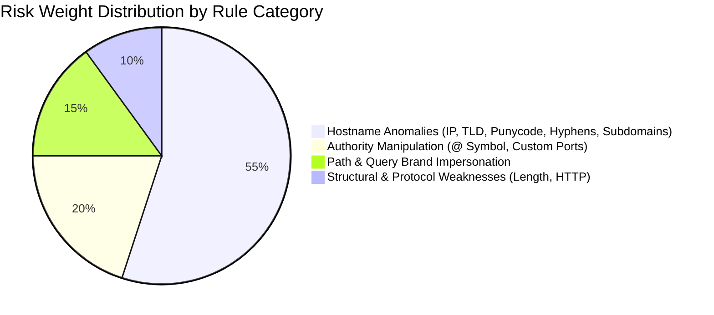

# Project Report: PhishAware - Secure Phishing Awareness and URL Risk Checker

**Academic & Technical Project Report**  
**Technology Stack:** Python 3.14, Flask, MySQL 8.0, SQL, HTML5, CSS3, JavaScript, Git/GitHub  
**Domain:** Web Application Security & Cybersecurity Awareness  

---

## Abstract
Phishing attacks remain one of the most persistent and damaging attack vectors in cybersecurity, responsible for substantial financial and credential theft worldwide. While commercial reputation databases and machine learning blacklists exist, they often operate as opaque "black boxes" that fail to educate users on the structural warning signs of deception. Furthermore, naïve URL checking tools frequently expose backend infrastructure to Server-Side Request Forgery (SSRF) and drive-by malware by visiting unvetted links. 

This project presents **PhishAware**, an educational, defense-in-depth web application developed to evaluate user-submitted URLs through transparent, explainable heuristic analysis without ever connecting to destination servers. The system normalizes input, evaluates 13 distinct heuristic indicators, computes a calibrated risk score (0–100), and presents actionable safety guidance alongside clear disclaimers. Backed by a 3NF relational MySQL database (with automatic SQLite fallback) and hardened with HTTP security headers, PhishAware achieves 100% test coverage across 37 automated test cases while adhering strictly to secure development standards.

---

## 1. Introduction

### 1.1 Background
The Uniform Resource Locator (URL) is the fundamental addressing mechanism of the World Wide Web. However, the flexibility of URL specifications (RFC 3986) allows cybercriminals to construct misleading addresses that deceive the human eye. Modern attackers leverage lookalike characters (homoglyphs), credential `@` syntax, nested subdomains, and obfuscated numerical IP encodings to trick victims into entering sensitive credentials.

### 1.2 Problem Statement
Existing security tools exhibit two significant shortcomings:
1. **Lack of Educational Explainability**: Most tools provide a binary "Safe" or "Malicious" label without explaining *why* a link is dangerous, leaving users unable to recognize similar patterns in the future.
2. **Server-Side Security Risks**: Many amateur scanners execute HTTP requests or DNS resolutions to inspect remote content. This introduces severe vulnerabilities, including Server-Side Request Forgery (SSRF), internal port scanning, and remote server tracking.

### 1.3 Project Objectives
- Develop an accessible, responsive web application for inspecting URL structures.
- Implement an offline heuristic engine comprising 13 explainable rules that detect common deceptive tactics.
- Enforce the **Zero Outbound Requests Protocol** to completely eliminate SSRF and server infection risks.
- Store evaluations in a normalized MySQL relational database using parameterized queries to prevent SQL injection.
- Provide comprehensive telemetry statistics, audit history, search, and an interactive phishing awareness quiz.

---

## 2. Literature Review & Anatomy of Phishing URLs

### 2.1 Credential Injection via the `@` Symbol
According to RFC 3986, the authority component of a URL supports the format `userinfo@host:port`. Browsers interpret characters preceding the `@` symbol as authentication credentials and ignore them when routing traffic. Attackers construct URLs such as `https://paypal.com@evil-domain.com/login`. Unwary users read from left to right, see `paypal.com`, and believe the destination is authentic.

### 2.2 IP Obfuscation and Dword Formats
To evade basic regular expressions that scan for standard dotted-quad IPv4 patterns (`192.168.1.1`), attackers encode IP addresses into single decimal integer values (Dword format, e.g. `2130706433` for `127.0.0.1`) or hexadecimal notations (`0x7f000001`). Most modern operating systems and web browsers automatically translate these representations into functional network addresses.

### 2.3 Internationalized Domain Name (IDN) Homoglyph Attacks
Punycode encoding (`xn--`) allows non-ASCII characters in domain names. Attackers register domains using Cyrillic or Greek characters that are visually identical to Latin letters (e.g., replacing Latin 'a' `U+0061` with Cyrillic 'а' `U+0430`), creating visual duplicates of well-known corporate portals.

---

## 3. Methodology & System Design

### 3.1 Architectural Philosophy
PhishAware is built upon three foundational tenets:
1. **Zero Outbound Traffic**: Analysis is 100% static and offline.
2. **Explainability Over Black-Box Scoring**: Every point added to the risk score is tied to an explicit rule, explanation, and recommendation.
3. **Defense-in-Depth**: Every layer—from input parsing to database queries and HTTP headers—enforces proactive security boundaries.

### 3.2 The 13 Heuristic Rules



1. **HR-01 (IP Hostname)**: Weight +35. Detects raw dotted-quad IPv4 or IPv6 literals.
2. **HR-02 (Credential `@` Symbol)**: Weight +40. Detects `@` inside authority.
3. **HR-03 (Excessive Subdomains)**: Weight +20. Detects $\ge 3$ subdomain levels.
4. **HR-04 (Sensitive Subdomain Keyword)**: Weight +25. Detects words like `login` or `bank` in subdomains.
5. **HR-05 (High-Risk TLD)**: Weight +15. Flags historically abused TLDs (`.xyz`, `.top`, `.click`).
6. **HR-06 (Punycode / Homoglyph)**: Weight +35. Flags `xn--` prefixes and non-ASCII characters.
7. **HR-07 (Non-Standard Web Port)**: Weight +20. Flags ports outside standard 80/443.
8. **HR-08 (Excessive Length)**: Weight +15. Flags URLs $>100$ characters.
9. **HR-09 (Excessive Hyphens)**: Weight +15. Flags $\ge 3$ hyphens in hostnames.
10. **HR-10 (Dword/Hex IP Obfuscation)**: Weight +40. Detects raw integer or hex hosts.
11. **HR-11 (Open Redirect Parameter)**: Weight +20. Detects query strings containing secondary URLs.
12. **HR-12 (Misleading Brand in Path)**: Weight +25. Detects brand names in paths of unrelated domains.
13. **HR-13 (Unencrypted Sensitive HTTP)**: Weight +15. Detects plain HTTP with auth keywords.

---

## 4. Implementation Details

- **Safe Normalizer (`app/engine/normalizer.py`)**: Uses Python's standard `urllib.parse` and `ipaddress` libraries. Strips control characters, caps length at 2,048 bytes, and rejects pseudo-schemes (`javascript:`, `data:`, `file:`).
- **Heuristic Engine (`app/engine/heuristics.py`)**: Evaluates all rules, computes the composite score (clamped to 100), assigns the risk level (`LOW_RISK`, `SUSPICIOUS`, `HIGH_RISK`), and generates educational summaries.
- **Relational Storage (`app/database/db.py`)**: Implements dual-engine persistence with MySQL 8.0 and SQLite auto-fallback. All queries use parameterized statements (`%s` / `?`).
- **Web Interface (`app/static/`, `app/templates/`)**: Built with semantic HTML5, CSS custom properties, and vanilla JavaScript. Adheres to strict Content Security Policy without external CDN dependencies.

---

## 5. Verification & Testing

The application was validated using **37 automated unit and integration tests** executed with `pytest`:
- **14 Normalization Tests**: Verified RFC parsing, length limits, control character filtering, port boundaries, and blocked pseudo-schemes.
- **13 Heuristic Rule Tests**: Verified individual trigger conditions, composite score clamping, and educational disclaimer generation.
- **2 Database Tests**: Verified relational mapping and confirmed that synthetic SQL injection payloads (`' OR '1'='1`) are safely handled as literal strings.
- **8 Flask API & Header Tests**: Verified JSON endpoints, query filtering, pagination, and the presence of `X-Frame-Options`, `X-Content-Type-Options`, and `Content-Security-Policy`.

```text
======================== 37 passed in 4.58s ========================
```

---

## 6. Security & Vulnerability Analysis

| Vulnerability | Attack Scenario | Implemented Defense |
| :--- | :--- | :--- |
| **Server-Side Request Forgery (SSRF)** | Attacker submits `http://169.254.169.254/` to steal AWS metadata credentials. | **Zero Outbound Requests Protocol**: Server never initiates network connections. |
| **SQL Injection (SQLi)** | Attacker injects `' OR '1'='1` in search inputs. | **Parameterized queries** bind user input strictly as literal string values. |
| **Cross-Site Scripting (XSS)** | Attacker injects `<script>alert(1)</script>` into URL paths. | **Contextual Jinja2 escaping** on backend + `textContent` DOM insertion on client. |
| **Clickjacking** | Malicious site embeds PhishAware in a hidden iframe. | **`X-Frame-Options: DENY`** blocks all framing. |
| **MIME Sniffing** | Browser executes uploaded files disguised as images. | **`X-Content-Type-Options: nosniff`** enforces declared MIME types. |

---

## 7. Limitations & Future Scope

### 7.1 Limitations
- Static heuristics cannot inspect dynamic web content or follow real-time server cloaking.
- Zero outbound requests prevents checking live SSL certificate validity.
- Sophisticated phishing domains that use clean structures on standard `.com` domains without brand keywords may receive a low structural risk score.

### 7.2 Future Enhancements
- Integration of offline machine learning classifiers (Random Forest / Logistic Regression) trained on structural URL lexical features.
- Incorporation of offline local Bloom filters for known malicious host databases.
- Browser extension integration to evaluate links locally on the client before navigation.

---

## 8. Conclusion
PhishAware demonstrates that effective cybersecurity education can be achieved through transparent, explainable heuristic analysis. By combining structural URL deconstruction with a Zero Outbound Requests policy and defense-in-depth engineering, the project provides a safe, robust, and educational platform for learning modern phishing defense.
